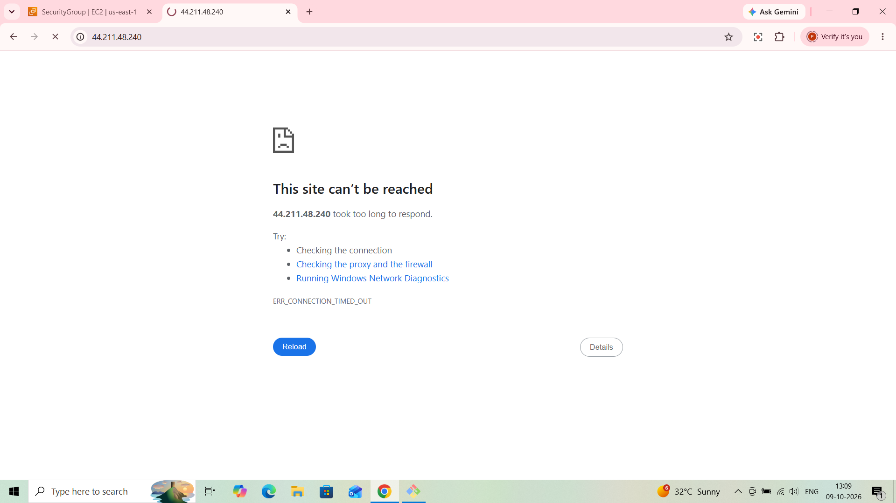
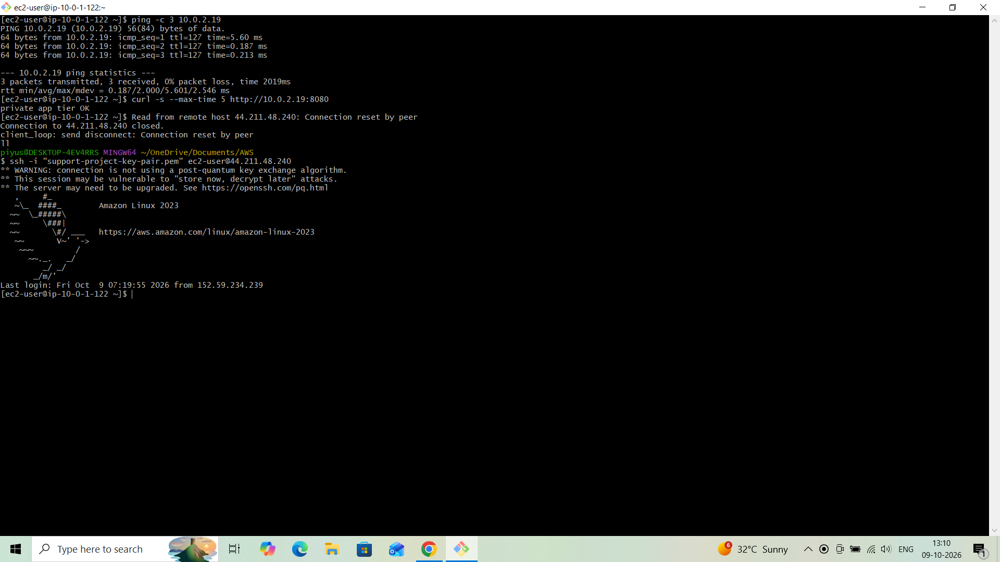
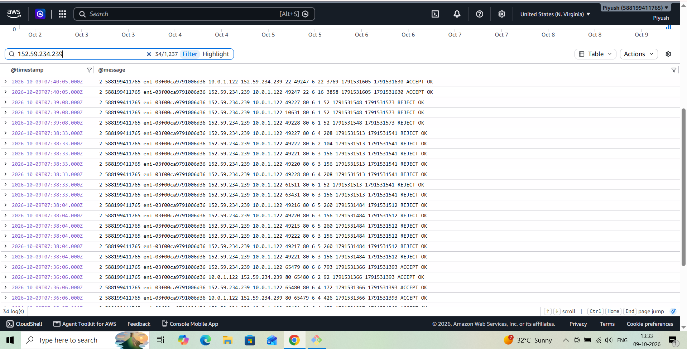
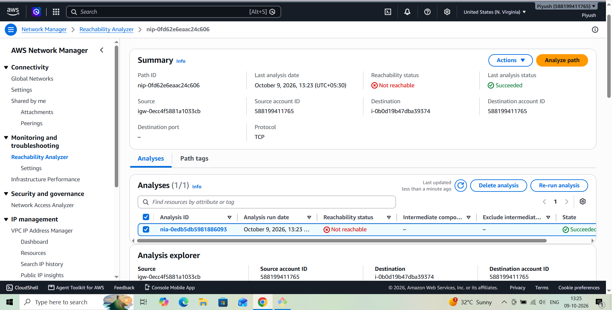
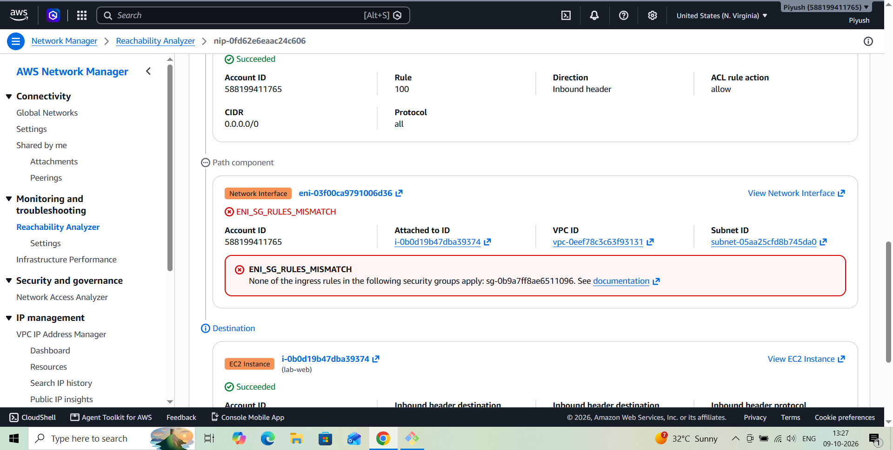
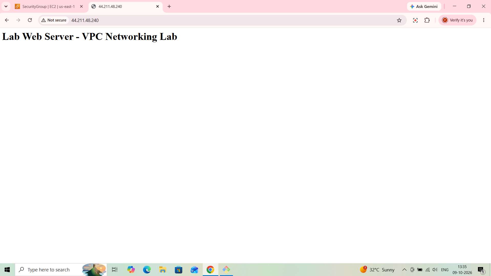

# AWS VPC Incident Postmortem 1 — Security Group Missing HTTP Rule (Simulated)

**Author:** Piyush Awasthi
**Date:** 9 October 2026
**Environment:** AWS `us-east-1` — `lab-vpc` (10.0.0.0/16), EC2 `lab-web` (public subnet, Apache) and `lab-private` (private subnet), VPC Flow Logs, Reachability Analyzer
**Severity:** SEV-3 — single lab instance, no customer impact
**Status:** Resolved

---

## 1. Summary

The inbound HTTP (port 80) rule was removed from the `web-sg` security group to simulate a misconfiguration. The website became unreachable from the internet and timed out, while SSH to the same instance kept working. VPC Flow Logs showed `REJECT` records for port 80, and Reachability Analyzer identified the security group as the blocking component (`ENI_SG_RULES_MISMATCH`). Re-adding the HTTP rule restored the site.

---

## 2. Timeline

| Time (UTC) | Event |
|---|---|
| 07:36:06 | Flow Logs show HTTP traffic from the admin workstation to `lab-web` (port 80) accepted in both directions — the working baseline |
| 07:36–07:38 | HTTP rule removed from `web-sg` (exact time not recorded; it falls between the last `ACCEPT` and the first `REJECT`) |
| 07:38:04 | First `REJECT` record for destination port 80; further rejects at 07:38:33 and 07:39:08 |
| 07:39 (13:09 IST) | Browser shows `ERR_CONNECTION_TIMED_OUT` |
| 07:40:05 | Flow Logs show a new SSH connection (port 22) accepted, so port 22 is still open |
| 07:42–07:43 | First Reachability Analyzer path, created without a destination port, reports **Reachable** despite HTTP being blocked (see Lessons Learned) |
| 07:53 (13:23 IST) | New path `lab-igw` → `lab-web`, TCP 80, reports **Not reachable** |
| 07:57 (13:27 IST) | Explanation reviewed: `ENI_SG_RULES_MISMATCH` naming `web-sg` |
| By 08:05 (13:35 IST) | HTTP rule restored; website loads again (exact time of the fix not recorded) |

*IST times from the workstation clock were converted to UTC (IST = UTC+5:30) to match Flow Logs.*

---

## 3. Detection

- **What alerted you?** A manual browser check. No automated alert exists for application reachability.
- **Time to detect:** Immediate in this exercise because the change was deliberate. In a real environment nothing would have notified anyone — detection would depend on a user report.

**Symptom — the website times out:**

---

## 4. Investigation

- **Reading the error:** `ERR_CONNECTION_TIMED_OUT` means packets are being silently dropped somewhere on the path (security group, network ACL, or routing). A *refused* connection would instead mean the packet arrived and nothing was listening.
- **Instance and network are otherwise healthy:** SSH to `lab-web` still worked, and from inside the instance `ping` and `curl` to the private tier (`10.0.2.19:8080`) succeeded (3/3 replies, `private app tier OK`). That points to a problem specific to port 80, not to the instance, routing, or the VPC.

- **VPC Flow Logs:** `REJECT` records for destination port 80 (TCP) from the workstation to `lab-web`'s interface, in contrast to the `ACCEPT` records for the same traffic a few minutes earlier. Flow Logs show *that* traffic was rejected, but not *which* component rejected it.

- **Reachability Analyzer:** path from Internet Gateway `lab-igw` to instance `lab-web`, TCP, port 80, returned **Not reachable**.

  The path passed the subnet's network ACL (rule 100, allow) and failed at the instance's network interface with:
  `ENI_SG_RULES_MISMATCH — None of the ingress rules in the following security groups apply: sg-0b9a7ff8ae6511096`

  *(The analyzer's Summary page displays Destination port as "–" for this path, while the analysis details record a destination port range of 80–80 in the packet header.)*

- **What was ruled out:** the network ACL (allowed in the path), routing and the internet gateway (SSH still worked), and the application (the private tier and Apache were healthy).
- **Root cause:** the HTTP inbound rule was missing from `web-sg`. Security groups deny all inbound traffic that no rule allows, so port 80 was dropped.

---

## 5. Resolution

- **Action taken:** re-added the inbound rule to `web-sg` — HTTP, TCP 80, source `0.0.0.0/0`.
- **Verification:** the website loaded again at 13:35 IST.

---

## 6. Impact

- **Who/what was affected:** inbound HTTP to one lab instance. The instance, SSH, and the private tier were unaffected.
- **Duration:** no more than about 30 minutes (07:36 to 08:05 UTC), much of it spent investigating and documenting rather than fixing.

---

## 7. Prevention / Follow-up Actions

- [ ] Add an application-level health check or alarm on port 80, so a blocked port alerts someone instead of being found manually.
- [ ] Manage security group rules as code (for example Terraform) so a removed rule shows up in review.
- [ ] Use CloudTrail to see who revoked the rule and when, and alert on `RevokeSecurityGroupIngress` for production groups.
- [ ] Keep a saved Reachability Analyzer path (internet gateway to web server, TCP 80) so triage takes one click.

---

## 8. Lessons Learned

A timeout means something is silently dropping packets, and the fact that SSH still worked narrowed the problem to one port within seconds. Flow Logs and Reachability Analyzer answer different questions: Flow Logs show that traffic was rejected, while the analyzer shows which component rejected it. An early analysis created without a destination port reported **Reachable** even though HTTP was blocked, because it was not testing port 80 — a reminder that a diagnostic tool is only as good as the question it is asked, so always specify the protocol and port.
