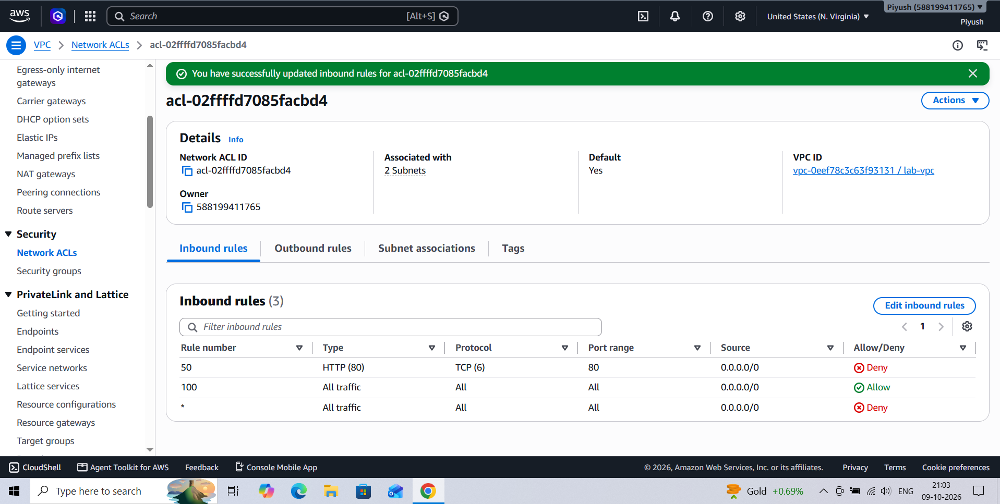
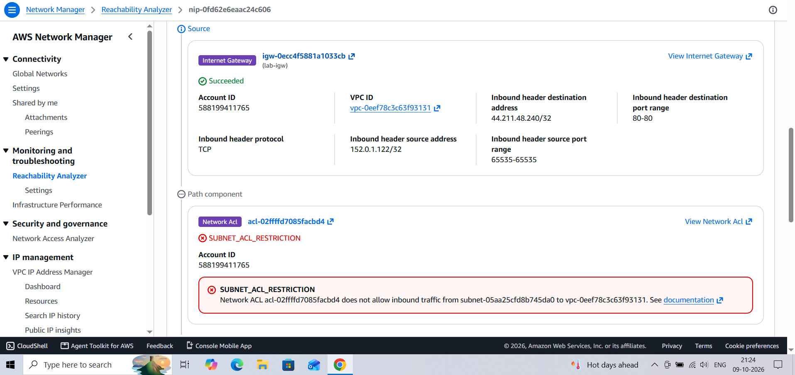
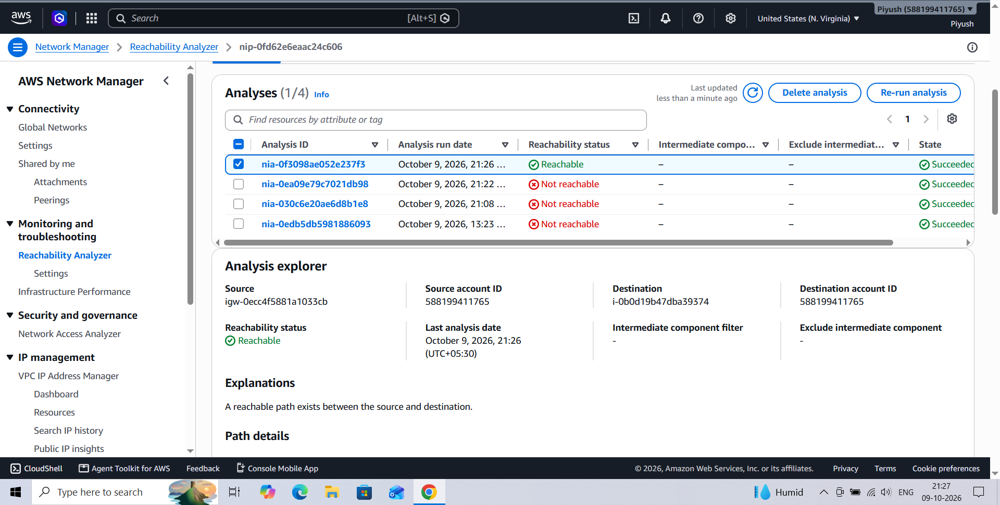

# AWS VPC Incident Postmortem 2 — Network ACL Deny Rule (Simulated)

**Author:** Piyush Awasthi
**Date:** 9 October 2026
**Environment:** AWS `us-east-1` — `lab-vpc` (10.0.0.0/16), EC2 `lab-web` (public subnet, Apache), default network ACL `acl-02ffffd7085facbd4`, Reachability Analyzer
**Severity:** SEV-3 — single lab instance, no customer impact
**Status:** Resolved

---

## 1. Summary

A deny rule for inbound TCP port 80 (rule number 50) was added to the VPC's default network ACL. Because rule 50 is evaluated before the default allow-all rule (100), HTTP was blocked at the subnet boundary even though the instance's security group allowed it. Reachability Analyzer reported the destination as not reachable and named the network ACL as the blocker (`SUBNET_ACL_RESTRICTION`). Deleting rule 50 restored reachability.

---

## 2. Timeline

| Time (UTC) | Event |
|---|---|
| 15:33 (21:03 IST) | Inbound rules of `acl-02ffffd7085facbd4` updated: rule 50 Deny TCP 80 from `0.0.0.0/0`, rule 100 Allow all, rule `*` Deny all |
| 15:38 (21:08 IST) | Reachability Analyzer (`lab-igw` → `lab-web`, TCP 80): **Not reachable** |
| 15:52 (21:22 IST) | Analysis re-run: **Not reachable** |
| 15:54 (21:24 IST) | Explanation reviewed: `SUBNET_ACL_RESTRICTION` naming the network ACL |
| Before 15:56 | Rule 50 deleted (exact time not recorded) |
| 15:56 (21:26 IST) | Analysis re-run: **Reachable** |

*IST times from the workstation clock were converted to UTC (IST = UTC+5:30).*

---

## 3. Detection

- **What alerted you?** Reachability Analyzer on the path `lab-igw` → `lab-web`, TCP port 80, which flipped from Reachable to **Not reachable** after the change.
- **Time to detect:** about 5 minutes, which was the time taken to run the analysis after making the change. In production nothing would have alerted without a health check.

**The rule that was added** (rule 50, Deny, ahead of the default allow):

The ACL is the VPC's default ACL and is associated with two subnets, so the change affected both.

---

## 4. Investigation

- **Security group ruled out:** the HTTP rule on `web-sg` had been restored at the end of the previous incident, and the site had served traffic since, so the security group was not the cause.
- **Reachability Analyzer:** the path failed at the network ACL with:
  `SUBNET_ACL_RESTRICTION — Network ACL acl-02ffffd7085facbd4 does not allow inbound traffic from subnet-05aa25cfd8b745da0 to vpc-0eef78c3c63f93131`
  The packet header confirmed the test was TCP, destination port 80.

- **Finding the exact rule:** the analyzer pointed to the ACL, and reading the ACL's inbound rules showed the cause: rule 50 (Deny, TCP 80) matches before rule 100 (Allow all). Network ACLs evaluate rules in ascending order and stop at the first match.
- **Root cause:** an explicit deny rule with a lower number than the allow rule, blocking HTTP for the whole subnet regardless of security group settings.

---

## 5. Resolution

- **Action taken:** deleted rule 50 from the ACL's inbound rules.
- **Verification:** the same Reachability Analyzer path was re-run and returned **Reachable**.

---

## 6. Impact

- **Who/what was affected:** inbound HTTP (TCP 80) from the internet was blocked at the network ACL for both subnets associated with the default ACL. No other protocols were affected.
- **Duration:** about 23 minutes between the rule change (15:33 UTC) and the confirmed fix (15:56 UTC).

---

## 7. Prevention / Follow-up Actions

- [ ] Avoid editing the default network ACL; use custom ACLs per tier so a change affects only the intended subnet.
- [ ] Alert on `CreateNetworkAclEntry` and `ReplaceNetworkAclEntry` in CloudTrail for production VPCs.
- [ ] Prefer security groups for access control and keep network ACLs simple, since they are stateless and easier to misconfigure.
- [ ] Keep a saved analyzer path for the main public route so a ticket can be triaged in one run.

---

## 8. Lessons Learned

Flow Logs would only have shown `REJECT` here, and they cannot tell a security group rejection from a network ACL rejection, whereas Reachability Analyzer named the ACL directly. It named the component but not the rule, so the last step was still reading the ACL's rules myself. Two concepts matter in practice: network ACL rules are evaluated in order from the lowest number, so a deny placed before an allow wins, and network ACLs are stateless, so return traffic on ephemeral ports (1024–65535) must be allowed explicitly, unlike security groups, which are stateful.
