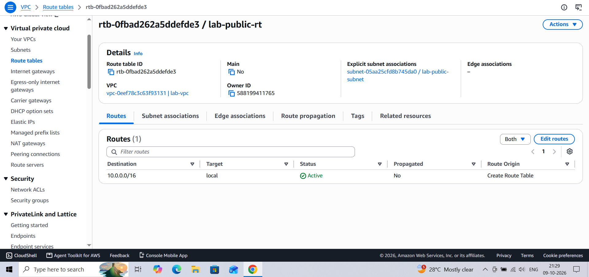
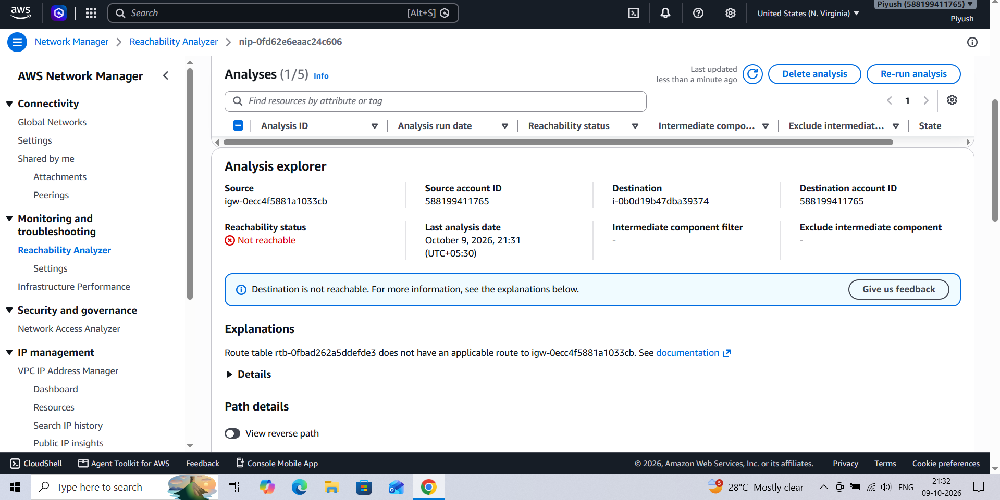
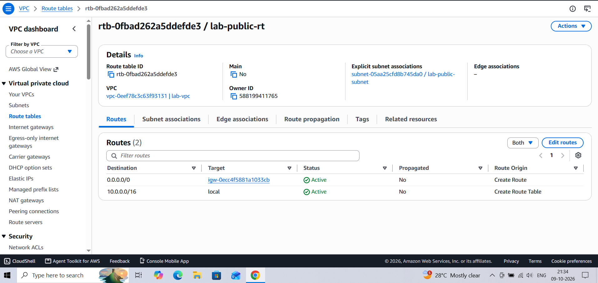

# AWS VPC Incident Postmortem 3 — Missing Route to the Internet Gateway (Simulated)

**Author:** Piyush Awasthi
**Date:** 9 October 2026
**Environment:** AWS `us-east-1` — `lab-vpc` (10.0.0.0/16), public route table `lab-public-rt` (`rtb-0fbad262a5ddefde3`), internet gateway `lab-igw`, EC2 `lab-web`, Reachability Analyzer
**Severity:** SEV-3 — single lab instance, no customer impact
**Status:** Resolved

---

## 1. Summary

The default route (`0.0.0.0/0` → `lab-igw`) was deleted from the public subnet's route table. The subnet was still associated with the correct route table, but the table contained only the local VPC route, so the subnet had no path to the internet gateway. Reachability Analyzer reported the destination as not reachable and stated that the route table has no applicable route to the internet gateway. Re-adding the route fixed it.

---

## 2. Timeline

| Time (UTC) | Event |
|---|---|
| ~15:58 | Default route `0.0.0.0/0` → `lab-igw` deleted from `lab-public-rt` (exact time not recorded) |
| 15:59 (21:29 IST) | Route table shows a single route (`10.0.0.0/16` local); explicit association with `lab-public-subnet` is intact |
| 16:01 (21:31 IST) | Reachability Analyzer (`lab-igw` → `lab-web`, TCP 80): **Not reachable** |
| 16:04 (21:34 IST) | Route restored: `0.0.0.0/0` → `igw-0ecc4f5881a1033cb` shown as Active alongside the local route |

*IST times from the workstation clock were converted to UTC (IST = UTC+5:30).*

---

## 3. Detection

- **What alerted you?** Reachability Analyzer on the path from the internet gateway to `lab-web`.
- **Time to detect:** about 2 minutes from inspecting the route table to a confirmed analyzer result. Nothing automated would have alerted in a real environment.

**The route table with the internet route missing:**

---

## 4. Investigation

- **Earlier causes already excluded:** the security group rule and the network ACL rule from the previous two incidents had both been restored before this test, so neither could be the cause.
- **Route table inspection:** `lab-public-rt` had exactly one route (`10.0.0.0/16`, local), and the explicit subnet association with `lab-public-subnet` was present. The association was correct, but the table had no route to the internet.
- **Reachability Analyzer:** the path failed with:
  `Route table rtb-0fbad262a5ddefde3 does not have an applicable route to igw-0ecc4f5881a1033cb`

- **Root cause:** the public subnet's route table had no `0.0.0.0/0` route to the internet gateway. A subnet is only "public" because its route table sends non-VPC traffic to an internet gateway, so removing that route effectively made the subnet private.

---

## 5. Resolution

- **Action taken:** added a route to `lab-public-rt`: destination `0.0.0.0/0`, target `lab-igw`.
- **Verification:** the route table shows both routes as Active.

---

## 6. Impact

- **Who/what was affected:** the public subnet had no path to or from the internet while the route was missing, so inbound internet access to `lab-web` was blocked (website and SSH not separately tested during this incident). Traffic within the VPC was unaffected because the local route remained.
- **Duration:** roughly 6 minutes between the change and the confirmed fix.

---

## 7. Prevention / Follow-up Actions

- [ ] Manage route tables as code (for example Terraform) so route deletions are visible in review.
- [ ] Alert on `DeleteRoute` and `ReplaceRoute` in CloudTrail for production route tables.
- [ ] When troubleshooting, check both halves: the subnet's association with a route table, and the routes inside it. A missing association (the subnet falling back to the main route table) produces the same symptom.
- [ ] Add a synthetic health check that exercises the public path end to end.

---

## 8. Lessons Learned

The instance, security group, and network ACL were all fine, yet the instance was unreachable, which shows that connectivity depends on the whole path, including routing. Reachability Analyzer was the fastest tool here because it named the exact route table and the missing destination, where Flow Logs would have shown nothing useful. Without a route there is no return path either, so a missing default route breaks traffic in both directions. This is a good example of a failure that can be diagnosed from the console alone, even when SSH access is gone.
