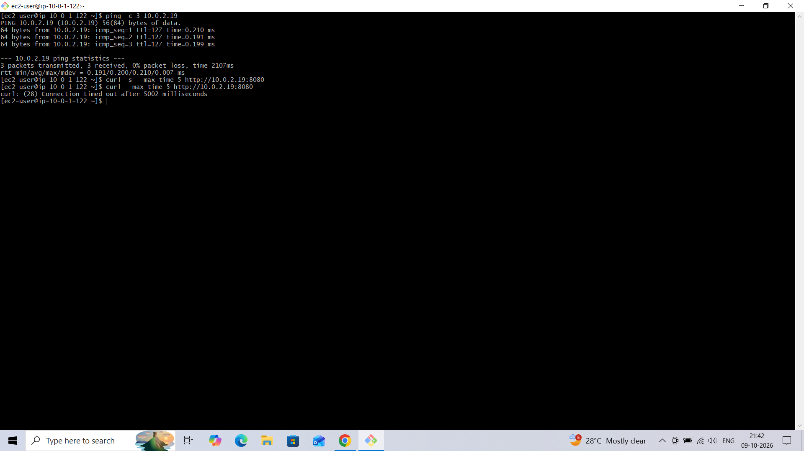
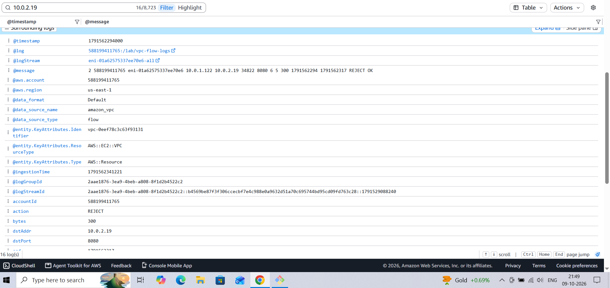
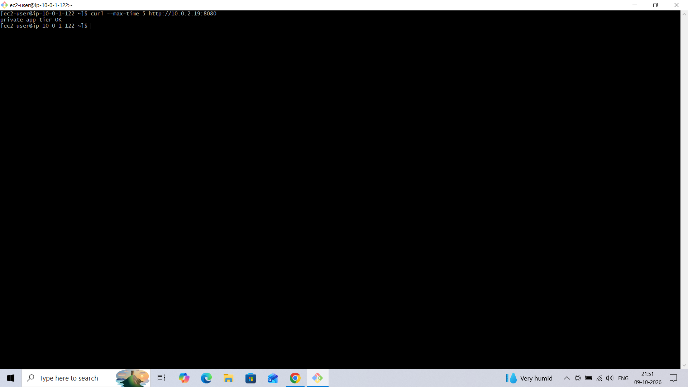

# AWS VPC Incident Postmortem 4 — Wrong Port on the Private Tier Security Group (Simulated)

**Author:** Piyush Awasthi
**Date:** 9 October 2026
**Environment:** AWS `us-east-1` — `lab-vpc` (10.0.0.0/16), web tier `lab-web` (10.0.1.122), private app tier `lab-private` (10.0.2.19, app on TCP 8080), security group `private-sg`, VPC Flow Logs
**Severity:** SEV-3 — single lab instance, no customer impact
**Status:** Resolved

---

## 1. Summary

The inbound rule on `private-sg` was changed from TCP 8080 to TCP 8081 while the app on `lab-private` kept listening on 8080. From the web tier, `ping` to the private instance still worked, but an HTTP request to port 8080 timed out. VPC Flow Logs recorded `REJECT` for destination port 8080. Restoring the rule to port 8080 (source: the web tier's security group) fixed it.

---

## 2. Timeline

| Time (UTC) | Event |
|---|---|
| Before 16:11 | `private-sg` inbound rule changed from TCP 8080 to TCP 8081 (exact time not recorded) |
| 16:11:34 | Flow Logs: first `REJECT` from `lab-web` (10.0.1.122) to `lab-private` (10.0.2.19) on port 8080 |
| ~16:12 (21:42 IST) | From `lab-web`: `ping` to 10.0.2.19 succeeds (3/3, 0% loss) but `curl` to port 8080 fails with a timeout after 5002 ms |
| 16:19 (21:49 IST) | Flow log record reviewed in CloudWatch Logs |
| By 16:21 (21:51 IST) | Rule restored to port 8080; `curl` returns `private app tier OK` |

*IST times from the workstation clock were converted to UTC (IST = UTC+5:30).*

---

## 3. Detection

- **What alerted you?** A failed request from the web tier to the private app during a manual connectivity test. No automated check covers the internal path.
- **Time to detect:** immediate, since the test was run right after the change.

**Symptom — ping works, the app request times out:**

(The first `curl` used the silent flag `-s`, which hides the error message and printed nothing. Re-running without `-s` showed `Connection timed out`.)

---

## 4. Investigation

- **Ping vs. TCP:** ICMP worked while TCP 8080 timed out. That proves routing and the subnets are fine, and that something specific to this port is dropping the traffic. The ICMP rule on `private-sg` was intact, which is why ping still succeeded.
- **Timeout vs. refused:** a timeout means a firewall (security group or network ACL) is silently dropping packets. If nothing had been listening on 8080, the error would have been *connection refused* instead.
- **VPC Flow Logs:** a `REJECT` record for TCP traffic from 10.0.1.122 to 10.0.2.19 on destination port 8080 (5 packets, 300 bytes, consistent with repeated connection retries), logged on the destination-side network interface.

- **Root cause:** `private-sg` allowed TCP 8081 but the application listens on 8080, so the security group dropped every connection attempt. Security groups deny anything not explicitly allowed.

---

## 5. Resolution

- **Action taken:** changed the `private-sg` inbound rule back to TCP 8080, with the source set to the web tier's security group (`web-sg`) rather than an IP range.
- **Verification:** the same `curl` from `lab-web` returned `private app tier OK`.

---

## 6. Impact

- **Who/what was affected:** connections from the web tier to the private app on port 8080. Basic network reachability (ping) and the web tier itself were unaffected.
- **Duration:** about 10 minutes between the first rejected connection (16:11 UTC) and the confirmed fix (by 16:21 UTC).

---

## 7. Prevention / Follow-up Actions

- [ ] Manage security group rules as code so a port typo is caught in review.
- [ ] Add a synthetic check from the web tier to the app port, so this failure alerts instead of being found manually.
- [ ] Keep using a security group as the rule's source (as in the fix) instead of an IP range. It stays valid when instance IPs change and limits access to only the web tier.
- [ ] Save a Reachability Analyzer path for `lab-web` → `lab-private`, TCP 8080, so a ticket can be triaged in one run.

---

## 8. Lessons Learned

Comparing ping with the application request was the fastest diagnostic here: it split the problem into "is the network up" and "is this port allowed" in two commands. The timeout-versus-refused distinction pointed to a firewall rather than the application. A practical detail from this incident: the `-s` flag on `curl` hides errors, so when a request returns nothing, re-run without it. Finally, Flow Logs confirmed the rejection and its exact port, which is a faster way to spot a port mismatch than reading rules by eye.
